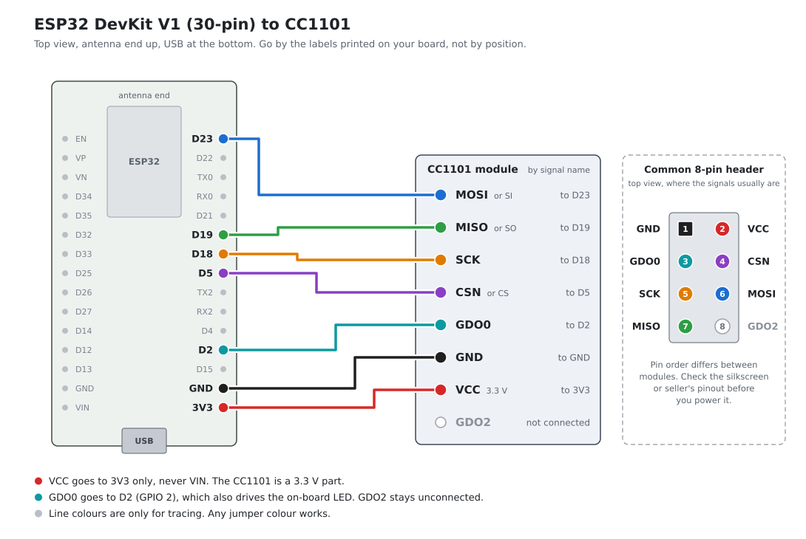
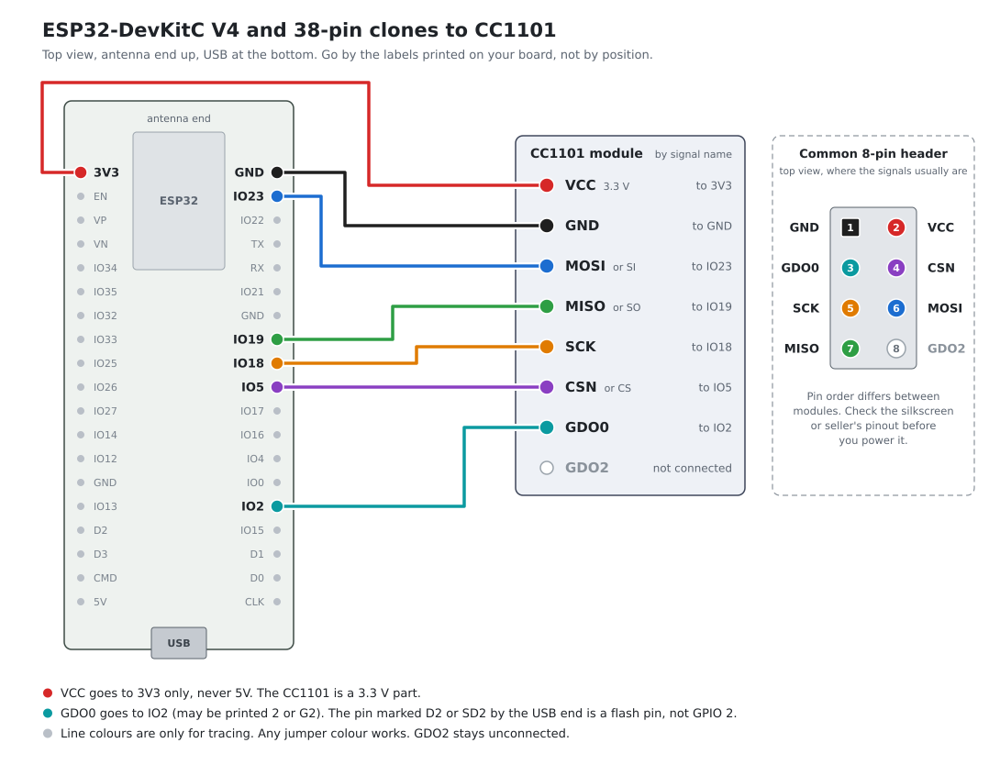

# FanSpitter prototype runsheet

Bench build of one unit: ESP32 DevKit + CC1101, learn one remote button, replay it, fan reacts.
Work top to bottom. Each stage ends in a **gate**; don't move on until it passes.

Status (2026-11-22, `prod-hardening`): one prototype built with this runsheet and working. It learned the remote's light button and replaying it toggled the fan's light. Getting there took three firmware fixes, listed under [What the bench turned up](#what-the-bench-turned-up). Stages 7 to 10 have not been run yet.

`pio` is not on `PATH` in zsh on this machine. Commands below use the full path `~/.platformio/penv/bin/pio`.

## 0. Before you touch hardware

**Parts on the bench**

- [ ] ESP32 DevKit (ESP32-WROOM, 4 MB flash) and a USB **data** cable (charge-only cables show no serial port)
- [ ] CC1101 module. Read the crystal can: it must say **26.000**. A 27 MHz clone lands the carrier 3.8% high.
- [ ] 7 female-female jumper wires. Go pin to pin and skip the breadboard: the module's 2×4 header can't straddle one.
- [ ] Antenna on the module. Most modules and their coil or SMA whip are tuned for 433 MHz, which suits a 433 MHz remote. For a remote near 303 MHz it still works at bench range; a straight 24 cm wire is a better match if range is poor.
- [ ] The fan remote, with a good battery
- [ ] 2.4 GHz WiFi name and password (the ESP32 can't see 5 GHz)
- [ ] MQTT broker host, port and credentials, if you want MQTT. Decide an OTA password too.

**Serial port access (this will block the first flash)**

`/dev/ttyUSB*` belongs to group `uucp` and your user isn't in it.

- [ ] Permanent fix, applies after you log out and back in:
  ```bash
  sudo usermod -aG uucp $USER
  ```
- [ ] If you don't want to log out now, stage 1 has a one-line workaround to run once the board is plugged in.

**Remote frequency (the biggest unknown)**

The carrier is `RF_FREQ_HZ` in [src/config.h](../src/config.h), default **433.957 MHz**, with a **203 kHz** receive filter. That default is this prototype's remote as measured. The project started out assuming 303 MHz; the remote turned out to be a 433.92 MHz one, so don't assume.

- [ ] Find the FCC ID on the back of the remote or in the battery bay and look up its operating frequency (fccid.io).
- [ ] If it is more than about 75 kHz from 433.957 MHz, set the frequency in `build_flags` in `platformio.ini` before flashing, for example:
  ```ini
  -DRF_FREQ_HZ=303875000
  ```

If you can't find the frequency, carry on as-is. Stage 5 will tell you: a receiver that is off-frequency logs nothing at all until the learn times out.

**Gate:** parts checked, crystal says 26.000, serial access sorted, frequency known or consciously skipped.

## 1. Flash the bare ESP32 (radio not wired yet)

Flash before wiring the CC1101. A freshly powered CC1101 outputs a clock on GDO0, which sits on GPIO 2, a boot-strapping pin, and that can make the first USB flash fail with "Wrong boot mode".

- [ ] Plug in the ESP32 alone. Confirm a port shows up (usually `/dev/ttyUSB0`, sometimes `/dev/ttyACM0`):
  ```bash
  ~/.platformio/penv/bin/pio device list
  ```
- [ ] If you haven't logged out since joining `uucp`, grant yourself the port for this session (redo after each physical replug):
  ```bash
  sudo setfacl -m u:$USER:rw /dev/ttyUSB0
  ```
- [ ] Flash and open the serial log:
  ```bash
  ~/.platformio/penv/bin/pio run -t upload -t monitor
  ```
  If it hangs on `Connecting....`, hold the **BOOT** button until the upload starts.
- [ ] Expect these lines, in among the core's own `[I]`/`[W]` and `*wm:` chatter:
  ```
  [FanSpitter] booting, firmware <git describe>  (ends in -dirty with uncommitted changes)
  [Store] Loaded 0 stored signals
  [CC1101] ERROR: unexpected chip ID — check wiring
  [App] ERROR: running without RF — check CC1101 wiring/power
  [App] Setup portal running: join WiFi "FanSpitter-Setup"
  [App] setup done
  ```
  The RF errors are correct here. There is no radio yet.

  A board that has been on your WiFi before may still hold those credentials. It then logs `[App] WiFi connected` and an IP instead of opening the portal, which is what this prototype did.

**Gate:** `setup done` in the log, and either the `FanSpitter-Setup` network is visible (allow 10–30 s) or the board has joined your WiFi.

## 2. WiFi and settings

Changing these later means a factory reset, so fill in everything now.

If the board joined your WiFi by itself in stage 1, the portal never opened and there is no OTA password or MQTT broker set. Hold **BOOT** for 5–30 s to wipe the WiFi settings and get the portal. This prototype is still in that state.

- [ ] Join `FanSpitter-Setup` from a phone. The portal opens by itself, or browse to `192.168.4.1`.
- [ ] Pick your WiFi and enter the password.
- [ ] Enter the MQTT broker details (or leave the host blank for web-only).
- [ ] **Set an OTA password.** With it set you can update over WiFi from here on, which sidesteps the GPIO 2 issue.
- [ ] Save. Expect:
  ```
  [App] Settings saved (MQTT <host>:<port>, topic fanspitter)
  [App] IP 192.168.x.x, RSSI -xx dBm
  [App] mDNS: http://fanspitter.local/
  [OTA] Ready at fanspitter.local:3232
  [App] HTTP server started
  ```
- [ ] Note the IP. Open `http://fanspitter.local/` (or the IP if the name doesn't resolve).

**Gate:** the web UI loads and this shows `"rf":false`:
```bash
curl -s http://fanspitter.local/api/status
```

## 3. Wire the radio

- [ ] **Unplug USB first.**
- [ ] Pick the diagram that matches your ESP32 board (count the header pins: 15 a side or 19 a side).

  **30-pin DevKit V1** (pins labelled `D23`, `D2`, `VIN`):

  

  **38-pin DevKitC V4 and clones** (pins labelled `IO23`/`23`, has `CMD` and `CLK`):

  

  The ESP32 side is drawn in true pin order. The CC1101 side is drawn by signal name, because module pin order is not standard. The dashed box shows the most common 8-pin layout; confirm yours against the silkscreen or the seller's pinout before powering it. On a module with an SMA connector you can check with a multimeter: the GND pin has continuity to the connector's outer shell.

- [ ] Wire by signal name. The same connections as a table:

  | CC1101 | ESP32 |
  |--------|-------|
  | VCC | **3V3** (never 5V or VIN; the CC1101 is a 3.3 V part) |
  | GND | GND |
  | MOSI (SI) | GPIO 23 |
  | MISO (SO) | GPIO 19 |
  | SCK | GPIO 18 |
  | CSN | GPIO 5 |
  | GDO0 | GPIO 2 |
  | GDO2 | not connected |

- [ ] Check VCC and GND a second time before powering up.

**Gate:** seven wires on, VCC confirmed on 3V3.

### As built (2026-11-22)

Jumper colours fitted to the CC1101 header, pins 1 to 8. The last column is where each jumper's other end goes on the ESP32. When the firmware was first flashed, none of them were on the ESP32 yet.

| Module pin | Jumper colour | Signal | Goes to (ESP32) |
|---|---|---|---|
| 1 | blue | GND | GND |
| 2 | green | VCC | 3V3 |
| 3 | yellow | GDO0 | GPIO 2 |
| 4 | orange | CSN | GPIO 5 |
| 5 | red | SCK | GPIO 18 |
| 6 | brown | MOSI | GPIO 23 |
| 7 | black | MISO | GPIO 19 |
| 8 | white | GDO2 | nothing: leave the free end loose and clear of other pins |

**Red and black are not power and ground on this build.** Red is SCK and black is MISO. Power is green, ground is blue.

Confirmed on hardware 2026-11-22: with this wiring the boot log reads `[CC1101] PARTNUM=0x00 VERSION=0x14` / `[CC1101] OK` and `/api/status` reports `"rf":true`. That proves power (green, blue) and the four SPI wires (orange, red, brown, black), and that this module follows the common 8-pin layout for those pins. GDO0 (yellow) was proven the same day: slot `light` was learned (66 pulses) and replaying it toggled the fan's light.

### What the bench turned up

Measured on this prototype with a temporary diagnostic firmware (not in the repo):

- **The remote:** carrier at 433.957 MHz as this CC1101 sees it, not 303 MHz. On-off keyed with pulses of about 260 µs and 750 µs, and 7.9 ms between repeats.
- **The module:** crystal confirmed at 26.000 MHz from the 135.415 kHz clock the chip puts on GDO0 after reset.

Three firmware bugs kept the radio deaf, all fixed in `src/`:

| Bug | Effect | Fix |
|---|---|---|
| `TEST0 = 0x09` forced the high VCO | Tuner did not lock at 303 MHz | `0x0B` |
| GDO0 set to `0x0C`, the synchronous data output | No data on GDO0 in async mode, even with the remote on-channel | `0x0D` |
| Frame gap threshold of 10 ms | The remote's 7.9 ms gap was never seen as a frame boundary | 5 ms, and capture records one frame from gap to gap |

## 4. Radio comes up

- [ ] Plug USB back in and reopen the log (press **EN/RST** if you missed the boot lines):
  ```bash
  ~/.platformio/penv/bin/pio device monitor
  ```
- [ ] Expect:
  ```
  [CC1101] PARTNUM=0x00 VERSION=0x14     (0x04 on some clones is also accepted)
  [CC1101] OK
  ```

**Gate:** `[CC1101] OK` in the log and `"rf":true` in `/api/status`.

If you get `unexpected chip ID` instead: all `0xFF` or all `0x00` means the chip isn't answering at all, so check power, MISO and CSN. Any other value means SPI is talking but garbled, so check MOSI and SCK and shorten the wires. Power-cycle after each change.

## 5. Learn one button

Start with the **light** button. The result is instant and obvious.

- [ ] In the web UI, enter slot name `light` and click **Start Learn**. You have 30 seconds.
- [ ] Hold the remote 20–30 cm from the antenna, then press and **hold** the button for about a second. The remote repeats its frame while held; one frame captures and the next confirms.
- [ ] Expect:
  ```
  [RF] Learn mode started — press remote button
  [RF] Frame 1 captured (N pulses) — press remote again
  [RF] Signal confirmed (N pulses)
  [Store] Saved "light" to slot 0 (N pulses)
  [App] Learned "light" (N pulses)
  ```
  A few `Pulse N mismatch` / `Frames didn't match` lines before `Signal confirmed` are normal. On this prototype it took 0.6 s and three rejected pairs, with N = 66.

**Gate:** `light` appears under Saved Signals.

| What the log shows | Likely cause | Try |
|---|---|---|
| Nothing until `[RF] Learn timeout` | Receiver isn't hearing the remote: wrong `RF_FREQ_HZ`, button not held, or GDO0 not connected | Hold the button for the whole window. Check the frequency per stage 0, then the GDO0 wire. |
| `Frame too short` repeating | Noise, no real frame | Move away from USB hubs and chargers |
| `Pulse N mismatch` / `Frames didn't match` for many seconds | Remote too close (stray 50 µs spikes) or too far | Back off to 20–30 cm, keep the button held |
| `ring buffer overflow` | A frame longer than 399 pulses, or the gap between repeats is under 5 ms | Lower `RF_FRAME_GAP_US` in `src/rf_learn.h` |

## 6. Replay it

- [ ] Click **Send** next to `light`. Expect `[RF] Transmitted N pulses x 8` and the light toggles.
- [ ] Repeat from where the unit will actually live, not just the bench.

**Gate:** the fan's light responds to Send, from the final location. On this prototype it has passed at the bench only.

If learn worked but the fan ignores the send: check the crystal (stage 0), move the unit closer to the fan, then raise `RF_TX_REPEATS` in `src/rf_learn.h`.

## 7. Survives a power cycle

- [ ] Unplug, replug. Expect `[Store] Loaded 1 stored signals` and it rejoins WiFi without the portal.
- [ ] Send still works.

**Gate:** prototype works. Everything below is optional.

## 8. Remaining buttons

- [ ] Learn the rest, 32 slots maximum (e.g. `fan_off`, `fan_low`, `fan_med`, `fan_high`). Names are 1–32 characters of letters, digits, `_` and `-`.

## 9. MQTT (if you configured a broker)

The Mosquitto clients aren't installed on this machine:
```bash
sudo pacman -S mosquitto
```

- [ ] Log shows `[MQTT] Connected` and `[MQTT] Subscribed to fanspitter/learn, fanspitter/cmd`.
- [ ] Watch status in one terminal:
  ```bash
  mosquitto_sub -h <broker> -t 'fanspitter/#' -v
  ```
- [ ] Trigger from another:
  ```bash
  mosquitto_pub -h <broker> -t fanspitter/cmd -m light
  ```

`[MQTT] Failed (rc=5)` is bad credentials; `rc=-2` is broker unreachable. Topics and the OpenHAB config are in the [README](../README.md#mqtt-topics).

## 10. OTA update

- [ ] Flash over WiFi with the password from stage 2:
  ```bash
  FANSPITTER_OTA_PASSWORD='your-ota-password' ~/.platformio/penv/bin/pio run -e ota -t upload
  ```
  Add `--upload-port <ip>` if `fanspitter.local` doesn't resolve.
- [ ] Learned signals are still there afterwards.

## If you need USB again later

With the radio wired, a USB flash can fail with "Wrong boot mode detected". Pull the GDO0 jumper off GPIO 2, flash, put it back. If that gets tedious, move GDO0 to GPIO 4 and uncomment `-DPIN_GDO0=4` in `platformio.ini`.

To change WiFi or MQTT settings: hold **BOOT** for 5–30 s and release. Learned signals are kept.
